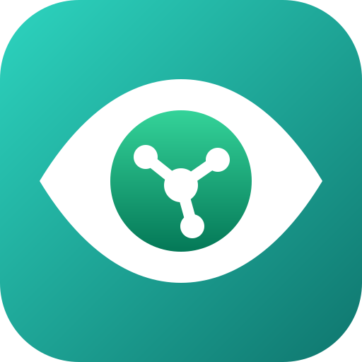

# ミエール（Mieru）

化粧品・スキンケア・サプリ・健康食品のパッケージ（表面・裏面の成分表）を撮影すると、AIが成分を読み取って翻訳し、
**日本の規制の観点**も含めて注意点を表示する試作Webアプリです。お土産や海外で買った商品など、
どの言語のラベルでも読み取れます。

## しくみ

```
写真（最大4枚） → ブラウザで縮小 → サーバー → Claude（画像を読み取り、決まった形式のJSONで返す）
                                               ↓
                       日本の規制チェック（キーワード照合・AIとは別に必ず実行）
                                               ↓
                     総合判定・成分一覧・日本での注意点・注意が必要な人 を表示
```

- 画面の言語：日本語 / English / 中文 / 한국어（結果もその言語で出力）
- 健康食品・サプリでは、次の内容もチェックします。
  - 表示の種類（トクホ／機能性表示食品／栄養機能食品／いわゆる健康食品／海外向けサプリ）と届出番号
  - アレルギー物質（特定原材料8品目は必ず表示）
  - ビタミン・ミネラルのとりすぎ（日本人の食事摂取基準の上限量と比較）
  - 薬との飲み合わせ、食品では認められない「病気が治る」などの表示
- **ミエールスコア（0〜100点・A〜E）**：100点から成分ごとに減点します（危険 −40、要注意 −20、注意 −8、ほぼ問題なし −2、
  表示の問題 −5）。危険な成分があれば最大20点、要注意なら最大50点です。AIに点数を付けさせず、毎回同じ式で計算します
  （`public/score.js`）。飲み合わせやアレルギーは人によって違うため、点数には含めません。
- **履歴・比較**：調べた結果はスマホのブラウザ内に保存されます（画像はサムネイルのみ）。2〜4個を選ぶと横並びで比較でき、
  価格を入れると1日あたりの値段を計算します。「AIに比べてもらう」で目的（例：疲れ目、薬を飲んでいる）に合うものを提案します。
- `lib/rules.js`：水銀、ステロイド、メラトニン、エフェドラ、医薬品成分（シブトラミン等）、THC/CBD、紅麹、
  セントジョーンズワート・イチョウ葉・ビタミンK（飲み合わせ）など、日本で注意が必要な成分の照合リストと、
  アレルギー8品目の検出（「ココナッツミルク」「乳化剤」などの誤検出を避ける工夫あり）。AIの判定より重い場合は総合判定を引き上げます。
- `DEMO_MODE=1` で起動すると**デモモード**になり、サンプル結果だけを表示します（画面の確認用）。

## 動かし方（おすすめ：Claudeのサブスクで動かす）

API料金をかけずに、PCにログイン済みの **Claude Code（`claude -p`）** で解析します。

```bash
# 事前に：Claude Code をインストールして、サブスクのアカウントでログインしておく
claude          # 初回のみ。ログインしたら /exit で終了

npm install
npm start       # http://localhost:3000  `Mieru: http://localhost:3000  [claude -p (subscription)]` と表示されればOK
npm test        # 規制チェックのテスト
```

- スマホで使うときは、PCと同じWi-Fiにつないで `http://<PCのIPアドレス>:3000` を開きます
  （写真はカメラで撮影してアップロードする方式なので、HTTPSでなくても使えます）。
- 1回の解析は30〜60秒ほどかかり、サブスクの利用上限にカウントされます。
- 環境変数 `ANTHROPIC_API_KEY` があっても、`claude -p` には渡さないようにしています（うっかりAPI課金にならないため）。

| 環境変数 | 内容 |
|---|---|
| `ANALYZER=api` | APIキー（従量課金）で動かす場合のみ指定。`ANTHROPIC_API_KEY` が必要 |
| `CLAUDE_MODEL` | 使うモデルを指定（省略時は Claude Code の既定） |
| `DEMO_MODE=1` | サンプル結果を返すだけ（画面の確認用） |
| `PORT` | ポート番号（既定 3000） |

### サブスクで動かす場合のルール

サブスクの `claude -p` は**自分のPCで、自分が使う**ためのものです。このアプリを公開して他の人にも使ってもらう場合は、
サブスクではなくAPIキー（`ANALYZER=api`）に切り替える必要があります。

## 注意

- 結果はAIによる参考情報で、医学的な診断ではありません。
- `lib/rules.js` の規制リストは代表例のみです。公開前に厚生労働省の化粧品基準・「専ら医薬品」リスト等で確認・追加してください。
- 撮影した画像は解析のためにAnthropicに送信されます（このアプリでは保存しません）。
- スマホのホーム画面に追加すると、ミエールのアイコンでアプリのように起動できます（Safariの共有ボタン →「ホーム画面に追加」）。
- 結果を表示したあとに言語を切り替えても、AIの解析文は解析時の言語のままです（再解析で切り替わります）。
